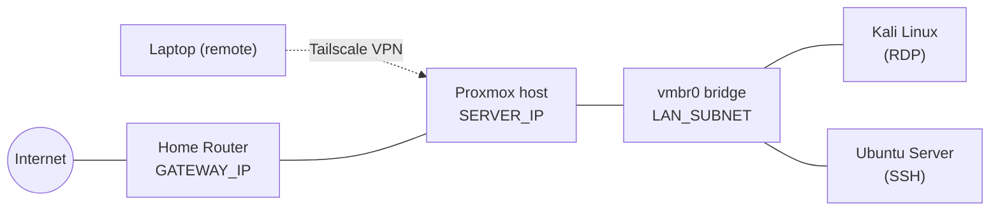

# Home Lab: Proxmox Virtualization and Security Lab

I turned an old Dell OptiPlex into a virtualization server so I could practise system administration, networking, and security outside of class. It runs multiple virtual machines that I can reach from anywhere, including full desktop access, without exposing anything to the internet.

I'm a Bachelor of Information Technology student (Computer and Communication Networks) at Centennial College, working toward a career in cybersecurity. This repo documents how I built the lab, including the problems I ran into and how I fixed them.

## Summary

- Installed **Proxmox VE** on bare metal to host multiple virtual machines
- Set up secure remote access with **Tailscale** (WireGuard VPN), with no ports opened on my home router
- Ran an external port scan against my own network to confirm nothing was exposed
- Built a **Kali Linux** VM with full remote desktop access (RDP), restricted to the VPN only
- Built and hardened an **Ubuntu Server** VM: SSH keys only, root login disabled, firewall, automatic updates

## Hardware

| Component | Spec |
|---|---|
| Machine | Dell OptiPlex 7020 |
| CPU | Intel Core i7, 4 cores / 8 threads |
| RAM | 18 GB |
| Storage | 500 GB SSD |
| Network | Wired Gigabit Ethernet |

## Network Overview

- The VMs connect to my home network through a Linux bridge (`vmbr0`).
- The Proxmox host acts as a Tailscale subnet router, so I can reach any VM remotely without installing Tailscale on each one.
- No port forwarding is configured on the router.

## Virtual Machines

| VM | OS | Purpose | Resources | Access |
|---|---|---|---|---|
| kali | Kali Linux | Penetration testing workstation | 2 vCPU, 4 GB RAM, 64 GB disk | RDP over Tailscale only |
| ubuntu-server | Ubuntu Server LTS | Linux server administration and hardening | 2 vCPU, 2 GB RAM, 32 GB disk | SSH with key authentication |

## Documentation

1. [Installing Proxmox VE](01-proxmox-setup.md)
2. [Secure Remote Access with Tailscale](02-remote-access-tailscale.md)
3. [Kali Linux VM and Remote Desktop](03-kali-vm-and-rdp.md)
4. [Ubuntu Server Setup and Hardening](04-ubuntu-server-hardening.md)

## What's Next

- Isolated attack lab: a separate virtual network with no internet access, using Metasploitable 2 as a target
- Windows 11 workstation
- OPNsense firewall for network segmentation and VLANs
- Windows Server and Active Directory
- Wazuh SIEM to monitor the lab and detect attacks
- RAM upgrade to 32 GB

## Skills Used

Proxmox VE, KVM/QEMU virtualization, Linux administration (Debian, Ubuntu, Kali), Linux networking and bridging, IP addressing and subnetting, Tailscale/WireGuard VPN, RDP (xrdp), SSH key authentication, UFW firewall, system hardening, troubleshooting, technical documentation
